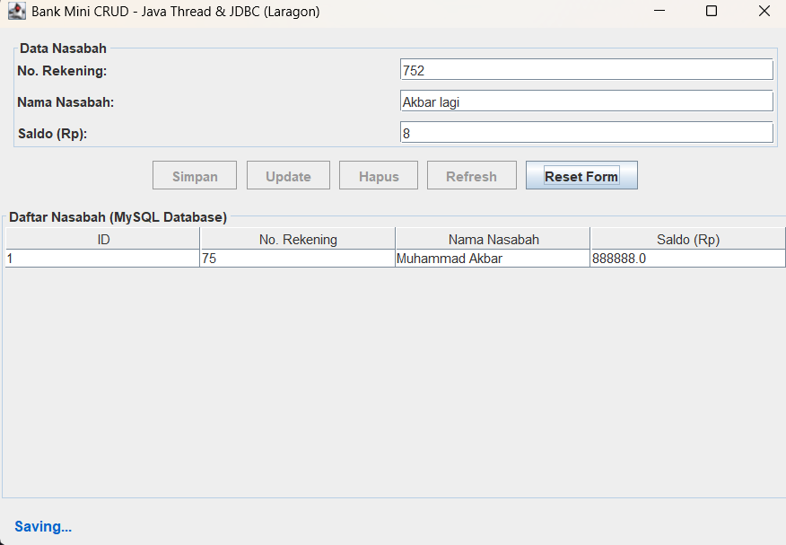
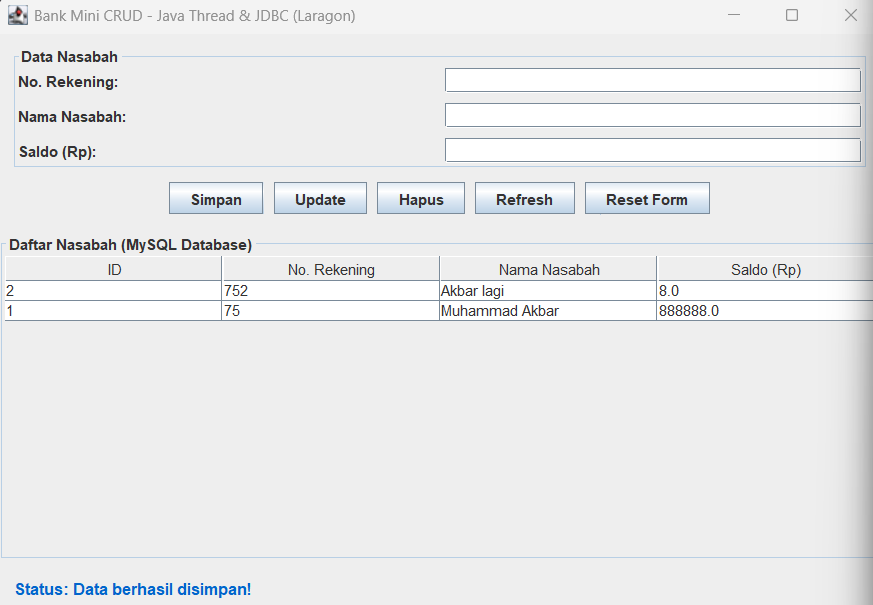
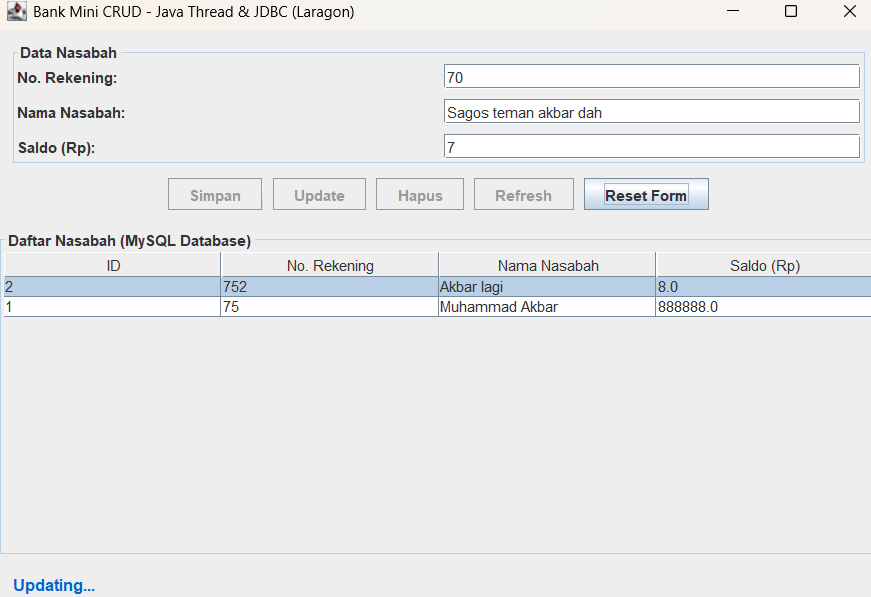
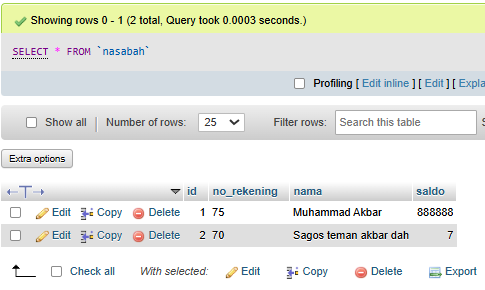
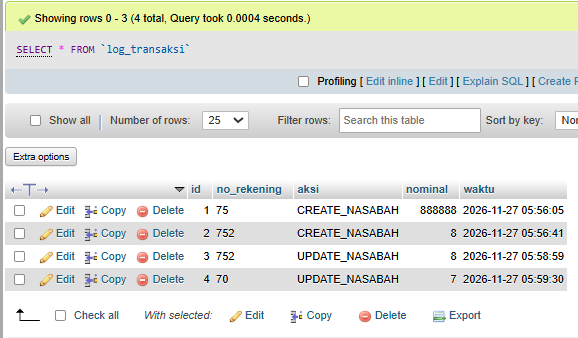

# Java Coding Practice - Thread & Database (JDBC) PBO 5C

Repositori ini berisi implementasi aplikasi desktop **Bank Mini CRUD** menggunakan **Java Swing**, **Multithreading**, dan **JDBC (MySQL pada Laragon)** untuk memenuhi tugas mata kuliah Pemrograman Berorientasi Objek Kelas 5C.

## Identitas Mahasiswa

- **Nama:** Muhammad Akbar
- **NIM:** F1D02410075
- **Kelas:** 5C - Teknik Informatika, Universitas Mataram

---

## Struktur Proyek

- `database.sql` — Skrip pembuatan database `db_pbo_bank` serta tabel `nasabah` dan `log_transaksi`.
- `lib/mysql-connector-j-*.jar` — Driver JDBC MySQL yang diimpor melalui _Referenced Libraries_ di VS Code.
- `src/DatabaseConnection.java` — Pengelola koneksi `DriverManager` ke MySQL (Laragon).
- `src/Nasabah.java` — Kelas model/entitas data nasabah.
- `src/NasabahDAO.java` — Implementasi _Data Access Object_ (CRUD).
- `src/BankAppGUI.java` — Antarmuka Swing lengkap dengan eksekusi _background thread_.
- `src/Main.java` — _Entry point_ aplikasi di _Event Dispatch Thread_ (EDT).

---

## Implementasi Ketentuan Tugas

1. **Konfigurasi Database & Connector:** Menggunakan server MySQL dari Laragon (`localhost:3306`) dengan driver `mysql-connector-j.jar` yang ditambahkan ke **JAVA PROJECTS → Referenced Libraries** di VS Code.
2. **CRUD dengan Pola DAO (`NasabahDAO.java`):**
   - **`Connection`:** Membuka koneksi database melalui `DatabaseConnection.getConnection()`.
   - **`PreparedStatement`:** Seluruh query `INSERT`, `SELECT`, `UPDATE`, dan `DELETE` menggunakan parameter `?` agar aman dari SQL Injection.
   - **Transaction (`commit` & `rollback`):** Setiap operasi `create`, `update`, dan `delete` menggunakan `conn.setAutoCommit(false)` untuk menulis ke tabel `nasabah` dan `log_transaksi` secara atomik, memanggil `conn.commit()` jika sukses dan `conn.rollback()` jika gagal.
   - **`ResultSet`:** Membaca hasil query `SELECT` baris demi baris menggunakan `rs.next()` pada method `findAll()`.
3. **Pola Threading (`DB on a thread → invokeLater → UI/GUI`):** Seluruh pemanggilan method DAO dijalankan di dalam `new Thread(() -> { ... }).start()` agar UI tidak _freeze_, lalu pembaruan tabel, form, dan label status dikembalikan ke _Event Dispatch Thread_ menggunakan `SwingUtilities.invokeLater(...)`.
4. **Feedback UI & Thread:** Saat tombol diklik, _click handler_ segera menonaktifkan tombol (`setControlsEnabled(false)`) dan mengubah teks `lblStatus` menjadi `"Saving..."` / `"Updating..."` / `"Deleting..."`, lalu mengaktifkan kembali tombol setelah thread selesai.

---

## Screenshot Program

### 1. Proses Thread Berjalan (Tombol Disabled & Label "Saving...")

### 2. Hasil CRUD pada Tabel GUI

### 3. Proses Update / Delete

### 4. Bukti Data & Log Transaction di MySQL (Laragon)

### tabel nasabah

### tabel log transaksi-nya

